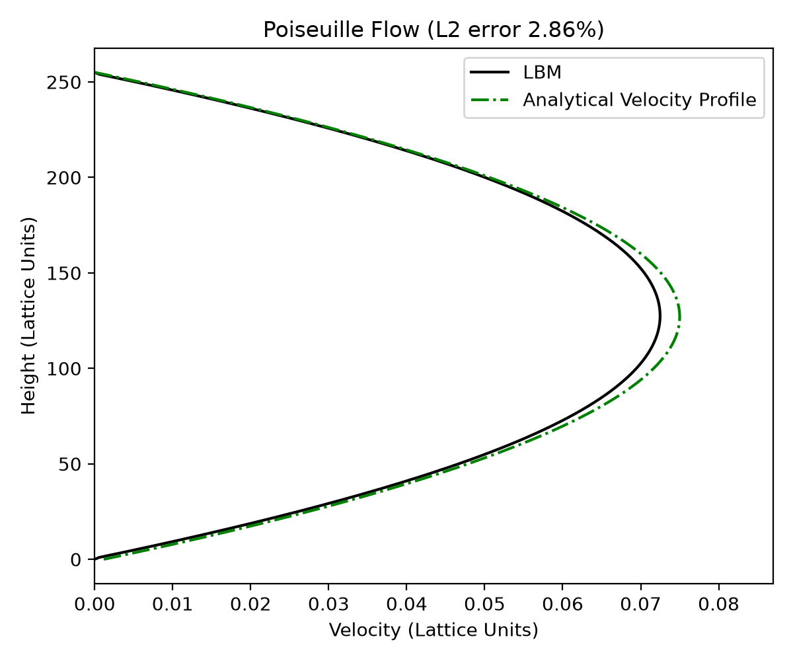

# LBM Solver & Web App Documentation

> Private working doc. Fill in each `TODO`; delete sections you don't need.
> Part A (sections 1–8) covers the solver in `src/`. Part B (sections 9–20) covers the web app in `web/` and `web_v3/`.
> Items marked *(from code)* were read from the source and should be re-checked when the code changes.

---

# Part A: Solver

## 1. Overview
- **Purpose:** The fluid flow solver computes the movement or distribution of fluid populations and how it flows past obstacles.
- **Method:** D2Q9 Lattice-Boltzmann, TRT collision, pull streaming, Zou-He Boundary Conditions
- **Backend:** Taichi Lang (CPU / GPU)
- **Web app:** Being Implemented

## 2. Installation

### 2.1 Requirements
| Item | Version                |
|------|------------------------|
| Python | 3.12 or older          |
| taichi | 1.7.4                  |
| numpy / matplotlib / colorama | 2.4.6 , 3.11.2 , 0.4.6 |

### 2.2 Steps
```bash
# macOS / Linux
./install.sh
source venvActivate.sh

# Windows
install.bat
```

On macOS/Linux, `install.sh` plays a terminal animation of flow past a cylinder while the packages install (about 37 s minimum). The full log goes to `install.log`. The animation is skipped when output is not a terminal (CI, piped output) or the window is too small. `source venvActivate.sh` plays a short flow-past-a-stenosis splash before activating the environment (set `LBM_NO_ANIM=1` to skip it).

### 2.3 Troubleshooting
| Symptom | Cause | Fix |
|---------|-------|-----|
| `No module named 'taichi'` | venv not activated | `source venvActivate.sh` |
| `taichi==1.7.4` fails to install | Python newer than 3.12 | Use Python 3.12 or older |
| `Error Code: 1` (warning) | Speed `u2 > 0.16` after step 3000, Mach limit exceeded | Lower inlet velocity |
| `Error Code: 2` (stops) | Negative distribution populations (`f < -1e-3`) | Same as above; check the `Location` printed to find the origin |
| `Error Code: 3` (warning) | Density outside 0.6–1.8 after step 3000 | Lower inlet velocity; check boundary setup |
| `Error Code: 4` (stops) | NaN in velocity, simulation diverged | Lower inlet velocity or raise viscosity (relaxation time) |

## 3. Running the Solver
```bash
cd src
python Simulator.py
```
- Select CPU/GPU: `ti.init(arch=type your choice here)` in `Simulator.py and Fields.py`
- Outputs: `Results/Result_1`
- Stop conditions: convergence (`tolerance`), instability (error codes 2, 4)

## 4. Governing Equations & Numerics
### 4.1 Lattice
- D2Q9 velocities `e_k`, weights `w_k`, `c_s^2 = 1/3`
### 4.2 Collision (TRT)
- `tau_s`, `tau_a`, magic parameter `Λ = 3/16`
- Viscosity: `ν = (tau_s - 0.5)/3`
### 4.3 Boundary conditions
| Boundary | Scheme | File | Notes                                      |
|----------|--------|------|--------------------------------------------|
| Inlet | Zou-He velocity | `Zou_he_inlet.py` | n/a                                        |
| Outlet | Zero-gradient | `Zero_Gradient_Outlet.py` | Advanced Outlet implementation in progress |
| Walls / obstacle | Half-way bounce-back | `TRT_and_Stream.py` | n/a                                        |
### 4.4 Units & scaling
- Lattice → physical conversion (`dx`, `dt`, `ρ`): TODO
- Reynolds number definition: `Re = TODO`

## 5. Parameters
| Name | Symbol | Value (default) | Where | Meaning |
|------|--------|-----------------|-------|---------|
| `nx, ny` | | 1024, 256       | `Fields.py` | Grid size |
| `tau_s` | τ | 0.884           | `Fields.py` | Relaxation time |
| `ux_target` | u_in | 0.05            | `Fields.py` | Inlet velocity |
| `tolerance` | | 1e-5            | `Fields.py` | Convergence threshold |

Stability limits: Mach `u² < 0.16`, `0.6 < ρ < 1.8`, `τ > 0.5`. All parameters must be under the given range for the simulator to run smoothly, and out-of-range values that occur during the simulation run will be detected by the Error Detection System (EDS).

## 6. Validation

### 6.1 Case A: Poiseuille flow
- **Setup:** `examples/Poiseuille.py`, grid 1024 x 256, `tau_s` 0.884, `u_max` 0.05, BCs: Top and bottom rows as obstacles/walls.
- **Analytical solution:** `u(y) = 4 u_max (y/H)(1 - y/H)`
- **Metric:** L2 relative error `‖u_num − u_ana‖₂ / ‖u_ana‖₂`
- **Result:** error = 2.85% L2 error norm at 1e-5 tolerance for convergence.
- **Figure:** `poiseuille_validation.png`



### 6.2 Case B: Grid convergence - Ongoing 
| Grid | L2 error | Observed order |
|------|----------|----------------|
| n/a | n/a      | — |

### 6.3 Case C: Von Kármán vortex street (`examples/Von_Karman.py`) - Ongoing
- Re = 100, measured Strouhal number = n/a, reference = n/a
- Replicating conditions tested by DFG flow around cylinder benchmark 2D-2, time-periodic case Re=100

### 6.4 Case D: Stenosis / plaque (scientific target)
- Geometry: `plaque_type`, `h_max`, `spread`

### 6.5 Known limitations
- Weakly compressible fluid assumption
- Newtonian Fluid
- constrained by python's overhead memory management, despite hardware acceleration using taichi.

## 7. Performance
| Backend | Grid       | MLUPS | Hardware                 |
|---------|------------|-------|--------------------------|
| CPU | 1024 x 256 | 214.7 | Macbook Air M4, 16gb RAM |
| GPU | n/a        | n/a   | n/a                      |

## 8. Project Layout
```
src/        solver kernels (one kernel per file; shared state in Fields.py)
examples/   validation / demo cases
Results/    simulation output (gitignored)
```
## 9. Current Progress
- Implementing a Web-based, interactive platform to be accessible for non-coders.
- Validating Von Karman Vortex Shedding according to DFG Case 2D-2 at Re = 100.
- Implementing Zou-He Outlet BC, with fixed pressure.

---

## References
1. Krüger et al., *The Lattice Boltzmann Method: Principles and Practice*, 2017.
2. Ginzburg et al., "Two-relaxation-time Lattice Boltzmann scheme", 2008.
3. Zou & He, "On pressure and velocity boundary conditions for the LBM", 1997.
4. Schäfer & Turek, "Benchmark computations of laminar flow around a cylinder" (DFG benchmark, 2D-2 time-periodic case, Re = 100), in *Flow Simulation with High-Performance Computers II*, Notes on Numerical Fluid Mechanics 48, Vieweg, 1996, pp. 547–566.
